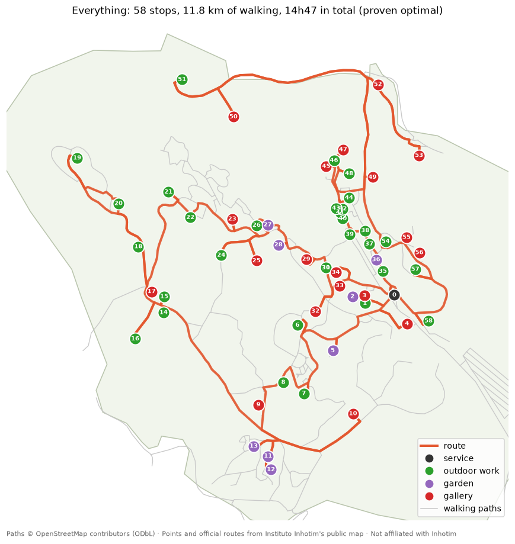
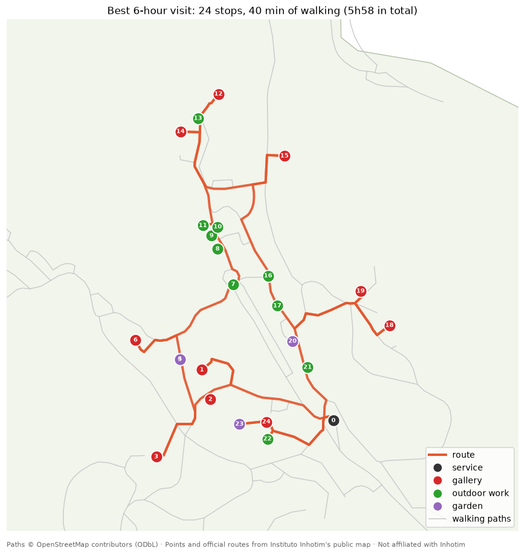

# inhotim-path

[](https://github.com/Andreixzc/inhotim-path/actions/workflows/ci.yml)

**Plan the best walking route through [Inhotim](https://www.inhotim.org.br/), built from the museum's live map.**

Inhotim (Brumadinho, MG, Brazil) is an open-air contemporary art museum and botanical garden.
Its galleries, outdoor artworks and themed gardens are spread across a large, hilly park, and
the collection changes over time. The official map shows *where* things are, but not *in which
order* to see them.

`inhotim-path` reads the museum's live map, turns it into a walking graph, and computes:

- 🧭 **the shortest route to see everything**: a Traveling Salesman Problem (TSP) over real walking paths;
- ⏱️ **the best route for the time you have**: an Orienteering Problem that maximizes your time with the art
  within a time budget, with your must-sees always included;
- 📅 *(planned)* slope-aware walking times, opening hours, multi-day plans, a web app and live GPS re-routing.

> **Status:** the command-line tool works end to end (Phase 1). Next up: better time estimates.
> See the [roadmap](docs/roadmap.md).

<p align="center">
  
  
</p>

Seeing *everything* means 58 stops, 11.8 km of walking and **14h47** in total: more than one visiting day.
Hence the time budget: the best 6-hour visit covers 24 stops with only 40 minutes of walking.

## How it works

```
Inhotim live map  ──► POIs (galleries, works, gardens) ─────────────┐
Official axes SVG ──► georeferenced routes ──┐                       ├─► snap POIs ─► walking-time matrix ─► solver ─► route
OpenStreetMap     ──► footpaths + park boundary ─► walking graph ────┘
```

More detail: [vision](docs/vision.md) · [data sources](docs/data-sources.md) · [architecture](docs/architecture.md)

## Quickstart

Needs [uv](https://docs.astral.sh/uv/). Data snapshots ship in [`data/`](data/), so routing works offline
right away.

```bash
git clone https://github.com/Andreixzc/inhotim-path.git
cd inhotim-path
uv sync
uv run inhotim-path route --budget 4h --start-time 10:00 --html output/route.html
```

```text
Inhotim route: 17 stops · 1.8 km walking (27 min) + 3h32 at stops = 3h59
walking speed 4 km/h · time at each stop: gallery 20m, outdoor_work 8m, garden 10m
time budget 4h00 · 41 stops left out

  #       time  stop                                            kind           walk from previous
  0      10:00  Recepção                                        service
  1      10:01  Bisected Triangle, Interior Curve               outdoor_work   91 m · 1 min
  2      10:10  Jardim Pictórico                                garden         56 m · 1 min
  3      10:22  Galeria Marcenaria                              gallery        134 m · 2 min
  4      10:43  Galeria Lago                                    gallery        91 m · 1 min
  ...
 15      12:51  Galeria Adriana Varejão                         gallery        163 m · 2 min
 16      13:13  Galeria Rivane Neuenschwander                   gallery        129 m · 2 min
 17      13:35  Galeria Cildo Meireles                          gallery        111 m · 2 min
 18      13:58  Recepção                                        service        214 m · 3 min
```

Open `output/route.html` for the route on a map. More examples:

```bash
uv run inhotim-path route                                   # everything (TSP), proven optimal
uv run inhotim-path route --budget 5h30 --must kusama "beam drop"
uv run inhotim-path route --budget 3h --kinds gallery --dwell gallery=30
uv run inhotim-path route --budget 6h --exclude cosmococa --geojson output/route.geojson
uv run inhotim-path fetch                                   # refresh data/ from the live map (rarely!)
```

| Option | Meaning |
|---|---|
| `--budget 4h` · `5h30` · `90m` | The best route that fits that time. Default: see everything. |
| `--must NAME…` | Must-see stops: a name or an artist, accents and case optional. |
| `--exclude NAME…` | Stops to skip. |
| `--kinds KIND…` | `gallery`, `outdoor_work`, `garden` (default), `exhibition`, `work_in_gallery`, `botanical`, `event`. |
| `--botanical` | Also stop at botanical highlights. |
| `--dwell KIND=MIN…` | Minutes at each kind of stop. Under a budget, also how much that kind counts. |
| `--speed KMH` | Walking speed (default 4). |
| `--start NAME` · `--start-time HH:MM` | Start/end point (default: Recepção) and clock times. |
| `--html PATH` · `--geojson PATH` | Write the route as a standalone map page or as GeoJSON. |
| `--time-limit SECONDS` | Solver search time (default 5). |

### How the route is chosen

- **Walking** follows real footpaths: OpenStreetMap, plus the museum's official routes where OSM has gaps.
- **Everything** (no budget): the shortest closed tour from the reception. It's proven optimal.
- **With a budget:** the route that spends the most minutes at stops, then walks the least. Must-sees are
  always in; if they can't fit, you're told so.
- **Solver:** [OR-Tools CP-SAT](https://developers.google.com/optimization/cp/cp_solver). The itinerary says when
  a route is proven optimal ([why CP-SAT](history/decisions/0004-cp-sat-circuit-solver.md),
  [why minutes](history/decisions/0005-stop-value-is-viewing-time.md)).
- **Assumptions:** walking at 4 km/h on flat ground (Inhotim is hilly: slope-aware times are planned) and
  guessed time per stop. Opening hours aren't modeled yet.

## Development

```bash
uv run pytest               # tests (no network needed)
uv run ruff check .         # lint
uv run ruff format .        # format
```

CI runs all of this on every push. Code layout and design: [architecture](docs/architecture.md).

## Project memory

This repo keeps a running log of working sessions and decisions in [`history/`](history/), so anyone
(human or AI assistant) can pick up exactly where the last session stopped.

## Disclaimer

Independent hobby project, **not affiliated with Instituto Inhotim**. Map data is fetched from the
museum's public website, and only factual metadata (names, coordinates, categories, links) is stored:
no photos or texts. Path data © [OpenStreetMap contributors](https://www.openstreetmap.org/copyright) (ODbL).

## License

[MIT](LICENSE)
