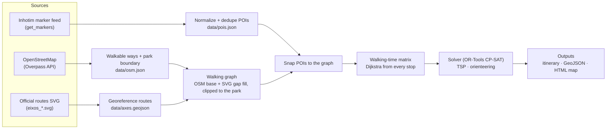

# Architecture

## Pipeline



The work is split into two stages with very different rhythms:

1. **`fetch`** (online, rare: daily at most): sources → snapshots in `data/`, committed to git.
   The snapshots double as an offline cache and as a changelog of the collection.
2. **`route`** (offline, fast: every request): `data/` → graph → matrix → solver → outputs.
   It never touches the network, so it's reproducible and testable.

## Modules (`src/inhotim_path/`)

| Module | Responsibility |
|---|---|
| `models.py` | Domain types: `Poi`, `PoiKind` |
| `http.py` | Shared HTTP client with the identifying User-Agent |
| `snapshots.py` | Read/write `data/` snapshots (skips writes when the content is unchanged) |
| `geo.py` | Local metric projection, haversine, Web Mercator SVG georeferencing |
| `sources/inhotim.py` | Fetch and normalize the marker feed; discover the SVG URL and overlay bounds |
| `sources/axes.py` | Parse and georeference the routes SVG |
| `sources/osm.py` | Overpass queries: park boundary and walkable ways |
| `network.py` | Build the walking graph: clip, fuse, node, snap POIs |
| `matrix.py` | All-pairs walking times (and paths) between stops |
| `solver.py` | CP-SAT circuit model: TSP and orienteering (time budget), with must-sees |
| `planner.py` | Glue: pick stops from a request, build graph + matrix, solve, lay out the timeline |
| `export.py` | Itinerary text, GeoJSON, standalone HTML map |
| `cli.py` | `inhotim-path fetch` / `inhotim-path route` |

## Cost model (v1)

- **Walking time** = path length / speed. The default is 4 km/h, a leisurely park pace; it's configurable.
- **Dwell time** by POI kind (defaults, all configurable with `--dwell`): gallery 20 min, outdoor work 8 min,
  garden 10 min, exhibition 20 min, work inside a gallery 5 min, botanical highlight 3 min.
- **Arc cost** i → j = dwell(i) + walk(i, j). The total route time is the sum of its arcs.
- **Value** of a stop, used when a time budget forces choices = its dwell minutes. The best route is the one that
  spends the most time with art, then the one that walks the least
  ([ADR 0005](../history/decisions/0005-stop-value-is-viewing-time.md)).
- **v2:** slope-aware speed with [Tobler's hiking function](https://en.wikipedia.org/wiki/Tobler%27s_hiking_function),
  `v = 6·e^(−3.5·|tan θ + 0.05|)` km/h, using elevation from a DEM. Uphill and downhill get different costs, so
  the graph becomes directed.

## Solver formulation (OR-Tools CP-SAT)

Why CP-SAT rather than the OR-Tools routing library: [ADR 0004](../history/decisions/0004-cp-sat-circuit-solver.md).

- **Model:** one circuit through the depot (the reception: start and end) and the stops, using CP-SAT's
  `AddCircuit`. There is a boolean per arc i → j, and a stop that is left out takes its self-loop instead.
  The chosen arcs add up to the route's total time.
- **TSP (`route`, default):** no self-loops, so every stop is in; minimize total time. The 58 default stops are
  proven optimal in about 0.2 s.
- **Orienteering (`route --budget 4h`):** total time ≤ budget; leaving stop i out costs
  `value(i) × (budget + 1)`. That penalty per value unit exceeds any route's time, so the objective is
  lexicographic: collect the most value, then take the least time.
- **Must-sees:** no self-loop, so they are mandatory even with a budget. If they can't fit, CP-SAT proves the
  model infeasible and the CLI says so.
- **Polish:** when a budget solve isn't proven optimal, the order of the chosen stops is re-solved as a small TSP,
  warm-started from the order found.
- **Search:** 8 parallel workers under a time limit (`--time-limit`, default 5 s). The itinerary says whether
  the route is proven optimal.
- **Multi-day (planned):** one circuit per day with each stop in at most one of them.

## Data contracts

`data/pois.json` (normalized snapshot):

```json
{
  "source": "https://www.inhotim.org.br/wp-admin/admin-ajax.php?action=get_markers",
  "fetched_at": "2026-11-01T05:30:00+00:00",
  "pois": [
    {
      "id": 3890,
      "name": "Galeria Praça",
      "kind": "gallery",
      "lat": -20.1229,
      "lng": -44.2193,
      "axes": ["amarelo"],
      "artists": [],
      "url": "https://www.inhotim.org.br/item-do-acervo/galeria-praca/",
      "main_view": true,
      "flags": []
    }
  ]
}
```

## Testing strategy

- **No network in tests.** Everything under `sources/` is split into a thin `fetch_*` (HTTP) and a pure
  `parse_*` / `normalize_*`. Tests feed the pure functions small fixtures.
- **Unit tests:** normalization and dedup rules, georeferencing math (round trips, known corners), graph
  building on synthetic lines, solver on toy matrices with known optimal tours, renderers on hand-made plans.
- **End-to-end tests:** planner and CLI on a synthetic park (`tests/synthetic_park.py`) where every distance can
  be checked by hand: snapshots are written to a temp dir and `inhotim-path route` runs on them.
- **CI:** ruff and pytest on every push (GitHub Actions).
