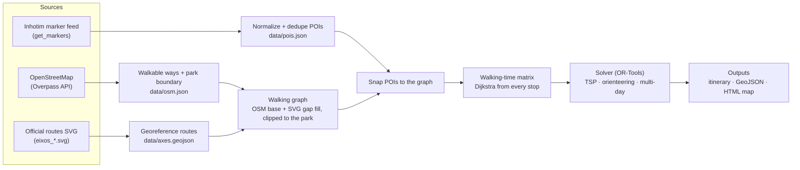

# Architecture

## Pipeline



The work is split into two stages with very different rhythms:

1. **`fetch`** (online, rare: daily at most): sources → snapshots in `data/`, committed to git.
   The snapshots double as an offline cache and as a changelog of the collection.
2. **`route`** (offline, fast: every request): `data/` → graph → matrix → solver → outputs.
   It never touches the network, so it's reproducible and testable.

## Modules (`src/inhotim_path/`)

| Module | Responsibility |
|---|---|
| `models.py` | Domain types: `Poi`, `PoiKind` |
| `geo.py` | Local metric projection, haversine, Web Mercator SVG georeferencing |
| `sources/inhotim.py` | Fetch and normalize the marker feed; discover the SVG URL and overlay bounds |
| `sources/axes.py` | Parse and georeference the routes SVG |
| `sources/osm.py` | Overpass queries: park boundary and walkable ways |
| `network.py` | Build the walking graph: clip, fuse, node, snap POIs |
| `matrix.py` | All-pairs walking times (and paths) between stops |
| `solver.py` | OR-Tools models: TSP, orienteering (time budget), multi-day |
| `export.py` | Itinerary text, GeoJSON, standalone HTML map |
| `cli.py` | `inhotim-path fetch` / `inhotim-path route` |

## Cost model (v1)

- **Walking time** = path length / speed. The default is 4 km/h, a leisurely park pace; it's configurable.
- **Dwell time** by POI kind (defaults, all configurable): gallery 20 min, outdoor work 8 min, garden 10 min,
  botanical highlight 3 min.
- **Arc cost** i → j = dwell(i) + walk(i, j). The total route time is the sum of its arcs.
- **v2:** slope-aware speed with [Tobler's hiking function](https://en.wikipedia.org/wiki/Tobler%27s_hiking_function),
  `v = 6·e^(−3.5·|tan θ + 0.05|)` km/h, using elevation from a DEM. Uphill and downhill get different costs, so
  the graph becomes directed.

## Solver formulation (OR-Tools routing)

- **Nodes:** depot (the reception, start and end) plus the stops. One vehicle per day.
- **TSP (`route`, default):** every stop is mandatory; minimize total time.
- **Orienteering (`route --budget 4h`):** each stop is *optional* through a disjunction whose penalty is its value.
  A time dimension caps each route at the budget. The solver trades walking time against the value of skipped
  stops, which maximizes the value collected within the budget.
- **Must-sees:** no disjunction, so they're mandatory even in budget mode.
- **Search:** first solution `PATH_CHEAPEST_ARC`, improved with `GUIDED_LOCAL_SEARCH` under a time limit (a few seconds).

## Data contracts

`data/pois.json` (normalized snapshot):

```json
{
  "source": "https://www.inhotim.org.br/wp-admin/admin-ajax.php?action=get_markers",
  "fetched_at": "2026-11-01T05:30:00+00:00",
  "pois": [
    {
      "id": 3890,
      "name": "Galeria Praça",
      "kind": "gallery",
      "lat": -20.1229,
      "lng": -44.2193,
      "axes": ["amarelo"],
      "artists": [],
      "url": "https://www.inhotim.org.br/item-do-acervo/galeria-praca/",
      "main_view": true,
      "flags": []
    }
  ]
}
```

## Testing strategy

- **No network in tests.** Everything under `sources/` is split into a thin `fetch_*` (HTTP) and a pure
  `parse_*` / `normalize_*`. Tests feed the pure functions small fixtures.
- **Unit tests:** normalization and dedup rules, georeferencing math (round trips, known corners), graph
  building on synthetic lines, solver on toy matrices with known optimal tours.
- **CI:** ruff and pytest on every push (GitHub Actions).
