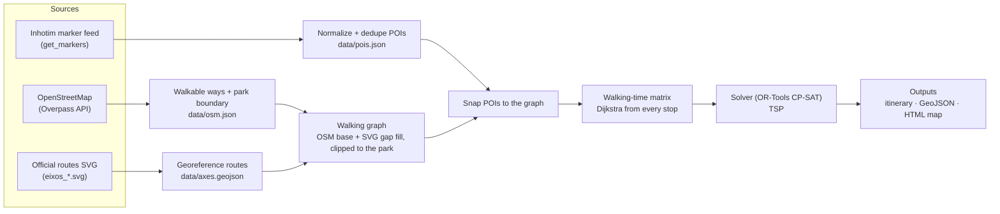

# Architecture

## Pipeline



The work is split into two stages with very different rhythms:

1. **`fetch`** (online, rare: daily at most): sources → snapshots in `data/`, committed to git.
   The snapshots double as an offline cache and as a changelog of the collection. A scheduled GitHub Action
   runs it every morning and commits only real changes, with a "what's new" report.
2. **`route`** (offline, fast: every request): `data/` → graph → matrix → solver → outputs.
   It never touches the network, so it's reproducible and testable.

## Modules (`src/inhotim_path/`)

| Module | Responsibility |
|---|---|
| `models.py` | Domain types: `Poi`, `PoiKind` |
| `http.py` | Shared HTTP client with the identifying User-Agent |
| `snapshots.py` | Read/write `data/` snapshots (skips writes when the content is unchanged) |
| `changes.py` | What changed between two POI snapshots: added, removed, renamed, moved (fetch's report) |
| `geo.py` | Local metric projection, haversine, Web Mercator SVG georeferencing |
| `sources/inhotim.py` | Fetch and normalize the marker feed; discover the SVG URL and overlay bounds |
| `sources/axes.py` | Parse and georeference the routes SVG |
| `sources/osm.py` | Overpass queries: park boundary and walkable ways |
| `network.py` | Build the walking graph: clip, fuse, node, snap POIs |
| `matrix.py` | All-pairs walking times (and paths) between stops |
| `solver.py` | CP-SAT circuit model: the shortest tour through every stop chosen (TSP) |
| `planner.py` | Glue: pick stops from a request, build graph + matrix, solve, lay out the timeline |
| `export.py` | Itinerary text, GeoJSON, standalone HTML map (MapLibre GL on OpenFreeMap tiles; optional MapTiler satellite view) |
| `webdata.py` | The park for the web app: every POI plus the walking network, as one compact JSON file |
| `cli.py` | `inhotim-path fetch` / `route` / `web-data` |

## Web app (`web/`)

A static page that plans in the browser ([ADR 0009](../history/decisions/0009-web-app-plans-in-the-browser.md)):
the shortest walk through every stop chosen, with no time limit and no times shown
([ADR 0010](../history/decisions/0010-web-app-without-times.md)).
Plain ES modules with no build step; MapLibre GL comes from cdnjs, pinned with SRI. The page reads
`web/data/park.json`, written by `inhotim-path web-data` (not committed; the Pages workflow builds it).

| Module (`web/js/`) | Responsibility |
|---|---|
| `network.js` | Dijkstra over the exported paths, walk shapes for the map, snapping a GPS position onto the paths |
| `solver.js` | The shortest walk through every stop: exact (Held-Karp) up to 12 stops, iterated local search beyond |
| `plan.js` | Mirror of `planner.py`: pick stops, walking-time matrix, solve, timeline, legs |
| `worker.js` | Runs `plan.js` off the main thread |
| `map.js` | OpenFreeMap liberty basemap with a plain fallback (light in dark mode too), route, stops and other POIs in kind colors, locate button, satellite toggle, and the canvas that plays a new route's animation |
| `reveal.js` | That animation's geometry and timing ([ADR 0014](../history/decisions/0014-map-shows-the-search-then-the-route.md)): the shortest-path wave from the start along every path, the route as one line, and the timeline |
| `app.js` | The form (category chips), the picker (stop by stop, or artist by artist), the itinerary, popups, and the glue between them |
| `state.js` · `format.js` · `i18n.js` | Settings: categories and stops added or skipped (localStorage + URL fragment), and each artist's stops; distances; Portuguese and English |

The modules without DOM code (`network`, `solver`, `plan`, `reveal`, `state`, `format`) are tested under node
(`tests/web/`). `tests/test_web_planner.py` runs `scripts/web_plan.mjs` to check that the JavaScript planner agrees
with the Python one, and `scripts/benchmark_web_solver.py` compares it with CP-SAT on the real park.

## Cost model (v1)

- **Walking time** = path length / speed. The default is 4 km/h, a leisurely park pace; it's configurable.
- **Dwell time** by POI kind (defaults, all configurable with `--dwell`): gallery 20 min, outdoor work 8 min,
  garden 10 min, exhibition 20 min, work inside a gallery 5 min, botanical highlight 3 min.
- **Arc cost** i → j = dwell(i) + walk(i, j). The total route time is the sum of its arcs.
- **No time limit** ([ADR 0015](../history/decisions/0015-no-time-budget-in-the-command-line.md)): every stop
  chosen is visited, so the time at stops is the same in any order. Speed and dwell times set the itinerary's
  clock, never the route.
- **v2:** slope-aware speed with [Tobler's hiking function](https://en.wikipedia.org/wiki/Tobler%27s_hiking_function),
  `v = 6·e^(−3.5·|tan θ + 0.05|)` km/h, using elevation from a DEM. Uphill and downhill get different costs, so
  the graph becomes directed.

## Solver formulation (OR-Tools CP-SAT)

Why CP-SAT rather than the OR-Tools routing library: [ADR 0004](../history/decisions/0004-cp-sat-circuit-solver.md).

- **Model:** one circuit through the depot (the reception: start and end) and the stops, using CP-SAT's
  `AddCircuit`, with a boolean per arc i → j. The chosen arcs add up to the route's total time.
- **TSP (`route`):** every stop is in, so minimizing the total time means walking the least. The 58 default stops
  are proven optimal in about 0.3 s, and all 89 with the botanical highlights in about 1 s.
- **Search:** 8 parallel workers under a time limit (`--time-limit`, default 5 s). The itinerary says whether
  the route is proven optimal.
- **Multi-day (planned):** one circuit per day with each stop in at most one of them.

## Data contracts

`data/pois.json` (normalized snapshot):

```json
{
  "source": "https://www.inhotim.org.br/wp-admin/admin-ajax.php?action=get_markers",
  "fetched_at": "2026-11-01T05:30:00+00:00",
  "pois": [
    {
      "id": 3890,
      "name": "Galeria Praça",
      "kind": "gallery",
      "lat": -20.1229,
      "lng": -44.2193,
      "axes": ["amarelo"],
      "artists": [],
      "url": "https://www.inhotim.org.br/item-do-acervo/galeria-praca/",
      "main_view": true,
      "flags": []
    }
  ]
}
```

## Testing strategy

- **No network in tests.** Everything under `sources/` is split into a thin `fetch_*` (HTTP) and a pure
  `parse_*` / `normalize_*`. Tests feed the pure functions small fixtures.
- **Unit tests:** normalization and dedup rules, georeferencing math (round trips, known corners), graph
  building on synthetic lines, solver on toy matrices with known optimal tours, renderers on hand-made plans.
- **End-to-end tests:** planner and CLI on a synthetic park (`tests/synthetic_park.py`) where every distance can
  be checked by hand: snapshots are written to a temp dir and `inhotim-path route` runs on them.
- **Web app:** `node --test tests/web/*.test.mjs` checks the solver against brute force on small instances (both
  the exact and the heuristic paths), the network, the planner on the synthetic park's export, and the settings.
- **CI:** ruff, pytest and the node tests on every push (GitHub Actions). After CI passes on `main`,
  `pages.yml` publishes the web app on GitHub Pages (<https://andreixzc.github.io/inhotim-path/>).
