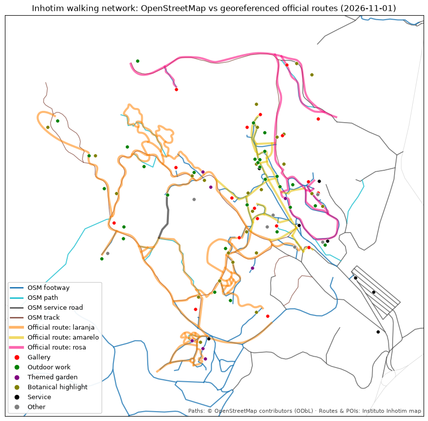

# Data sources

Findings from the research spike on **2026-11-01**. Counts are as of that date. They're a snapshot, not a contract.

## TL;DR

| What | Source | Coordinates? | Role |
|---|---|:-:|---|
| Attractions (POIs) | `GET https://www.inhotim.org.br/wp-admin/admin-ajax.php?action=get_markers` | ✅ | **Primary POI feed** |
| Official walking routes ("eixos") | SVG overlay referenced by `/mapa/` (`#map[data-axis]`) | ✅ after georeferencing | Gap-filling the walking network |
| Footpaths + park boundary | OpenStreetMap via the Overpass API | ✅ | **Base walking network** |
| Descriptions / thumbnails | `GET https://www.inhotim.org.br/wp-json/inhotim/mobile/map/points-of-interest` | ❌ | Optional enrichment (link only) |

## 1. How the official map works

`/mapa/` is a WordPress page (theme `inhotim`). The map is a **Google Maps JS** map created by the theme bundle
`/wp-content/themes/inhotim/dist/scripts/main_<hash>.js`:

- **Center and zoom:** `#map[data-center-lat="-20.1242111"][data-center-lng="-44.2218008"][data-zoom="16"]`.
- **Markers:** `$.ajax({url: $(".main").data("ajax-url"), data: {action: "get_markers"}})`, which resolves to
  `admin-ajax.php?action=get_markers`.
- **Routes overlay:** a custom `google.maps.OverlayView` that stretches the image at `#map[data-axis]`
  (e.g. `/wp-content/themes/inhotim/dist/images/eixos_5f2dbdef.svg`) over bounds hardcoded in the bundle:
  - SW `(-20.12903525, -44.22784743)`
  - NE `(-20.11823726, -44.21704688)`
- `robots.txt` only disallows `*.pdf`.

## 2. Marker feed: `get_markers`

Response shape: `{"success": true, "data": {"markers": [...]}}`, with **262 entries and 150 unique ids**.

| Field | Example | Notes |
|---|---|---|
| `id` | `3890` | WordPress post id. **Not unique within the feed** (see quirks). |
| `lat`, `lng` | `-20.1240764`, `-44.2184546` | Parse defensively (number or string). |
| `content` | `<div class="infowindow__content"><div class="infowindow__img"><a href=".../item-do-acervo/galeria-praca/">…<h1>Galeria Praça</h1>…` | HTML info window: title in `<h1>`, item URL in the first `<a href>`. |
| `group` | `["galeria"]`, `["galeria", "obra-em-galeria"]`, `"it_services"`, `null` | A list of category slugs, the string `"it_services"`, or `null` for events/exhibitions. |
| `category` | `<a href=".../categorias/galeria/">Galeria</a>` | HTML rendering of `group`. |
| `axis` | `["laranja"]` | Route color: `laranja` / `amarelo` / `rosa` (the site JS also accepts `orange` / `yellow` / `pink`). `[]` or `""` when none. |
| `artists` / `artists_names` | `[19179]` / `<a href="…">Name</a>` | Artist post ids / HTML links. |
| `main_view` | `true` | `false` means hidden on the default map. These are works **inside a gallery**, not separate stops. |
| `filters` | `{"novidades-do-acervo": ["novas-obras-e-exposicoes"]}` | Only on a few markers: "new works & exhibitions" / "reopened works & galleries". |

### Category breakdown (unique ids)

| `group` | Meaning | ~Count | Routing role |
|---|---|---:|---|
| `galeria` (± `obra-em-galeria`) | Gallery / pavilion | 20 | Stop |
| `artista` | Artist pinned on the map (Yayoi Kusama, i.e. her gallery) | 1 | Stop |
| `obras-a-ceu-aberto` | Outdoor work | 32 | Stop |
| `jardim-tematico` | Themed garden | 9 | Stop |
| `destaque-botanico` | Botanical highlight (a notable plant) | 31 | Optional stop |
| `obra-em-galeria` | Work inside a gallery (`main_view=false`) | 20 | Attribute of its gallery |
| `it_services` | Reception, parking, shop, clinic… | 9 | Start/end, amenities |
| `exposicoes`, `null` | Exhibitions, events, news | 14 | Time-bound; off by default |

### Quirks

- **Duplicates:** most ids appear twice, some three times, probably once per translation or category.
  14 ids have *differing* duplicates (other coordinates or `main_view`). Rule: group by id, prefer the
  `main_view=true` entry, and union the axes and flags.
- **Outliers:** one event sits ~3.6 km away from the park (off-site). Clip POIs to the park boundary plus a small buffer.
- **Undocumented endpoint:** no versioning and no contract. Validate the shape, fail loudly, and keep the last good snapshot.

## 3. Official routes SVG ("eixos")

- `viewBox="0 0 1009.7 1071.1"`, no `preserveAspectRatio` (so the default `xMidYMid meet` applies), no transforms.
- 24 `<path>` elements: groups `laranja` (12), `amarelo` (7), `rosa` (4), plus 1 outside the groups.
- The filename is content-hashed, so read it from `#map[data-axis]` instead of hardcoding it.

### Georeferencing

The overlay div spans the bounds in **Web Mercator pixel space**. The `` fills the div at 100% × 100%, and
the SVG is fitted inside it with `meet` (uniform scale, centered). In normalized Web Mercator coordinates:

```text
X(lng) = (lng + 180) / 360
Y(lat) = (1 − ln(tan φ + sec φ) / π) / 2                  (Y grows southward)

W = X(NE.lng) − X(SW.lng)        H = Y(SW.lat) − Y(NE.lat)
s = min(W / 1009.7, H / 1071.1)   ox = (W − 1009.7·s) / 2   oy = (H − 1071.1·s) / 2

svg (x, y) → X = X(SW.lng) + ox + x·s      Y = Y(NE.lat) + oy + y·s
           → lng = 360·X − 180             lat = atan(sinh(π·(1 − 2Y)))
```

The aspect ratios of the box and of the viewBox differ by only ~0.4%, so `meet` vs. a plain stretch moves points
by just a few meters. We still do it properly.

**Validation:** overlaid on OSM, the georeferenced routes line up with OSM ways within a few meters:



## 4. OpenStreetMap

- **Park boundary:** relation [`5418784`](https://www.openstreetmap.org/relation/5418784),
  "Centro de Arte Contemporânea Inhotim" (`leisure=park`, `amenity=arts_centre`). Not to be confused with
  relation `5418785`, the private nature reserve (RPPN).
- **Ways** with `highway=*` in the bbox `(-20.1345, -44.2330, -20.1140, -44.2120)`: 163 ways, made up of footway 64 (~11.1 km),
  service 41 (~12.2 km), track 20 (~4.4 km), path 12 (~2.4 km), plus public roads (`secondary`, `unclassified`)
  that must be excluded.
- **Coverage gaps:** some official routes (e.g. loops on the orange axis) have no OSM counterpart. These get filled from the SVG.
- **License:** ODbL. Attribution: "© OpenStreetMap contributors".

## 5. Other endpoints (not used yet)

- `GET /wp-json/inhotim/mobile/map/points-of-interest`: 209 items `{title, hash, thumbnail, description, tag}`, with
  no coordinates. Used by the official mobile app.
- `GET /wp-json/wp/v2/it_map_point` (166 items, `acf: []`), `it_collection_item`, `it_collection_axis`, `it_services`:
  standard WP REST routes; the coordinates are not exposed.
- `GET /wp-json/inhotim/mobile/program/thematic_tour`: empty on 2026-11-01. It might hold official suggested tours someday.

## 6. Fetching etiquette

- A full refresh is a handful of requests (map page, marker feed, SVG, theme bundle, Overpass). Run it **daily at most**.
- **Automated:** [`.github/workflows/refresh-data.yml`](../.github/workflows/refresh-data.yml) runs `fetch` once a day
  (06:17 in Brasília) and commits `data/` only when something changed
  ([ADR 0007](../history/decisions/0007-daily-data-refresh.md)).
- Identify the client: `User-Agent: inhotim-path/<version> (+https://github.com/Andreixzc/inhotim-path)`.
- Store only factual metadata. Never re-host photos or descriptions; link to the official item page instead.

## 7. Basemap tiles (HTML map only)

The CLI never downloads map tiles. The `--html` page loads them in the viewer's browser:

- **Source:** [OpenFreeMap](https://openfreemap.org/), style `https://tiles.openfreemap.org/styles/liberty`
  (vector tiles, drawn with MapLibre GL). No API key, no usage limits, commercial use allowed.
- **Attribution:** "OpenFreeMap © OpenMapTiles Data from OpenStreetMap". MapLibre adds it to the map.
- **Not `tile.openstreetmap.org`:** OSM's servers require a `Referer` from browsers, and a page opened from a
  file sends none. See [ADR 0006](../history/decisions/0006-basemap-openfreemap.md).

## 8. Satellite imagery (HTML map, optional)

- **Source:** [MapTiler](https://www.maptiler.com/cloud/) `satellite-v2` raster tiles. Needs the user's own key
  (`--satellite-key` or `$MAPTILER_API_KEY`). The free plan has no card and pauses at its quota instead of billing.
- **Loaded only on demand:** the page contacts MapTiler only after the "Satellite" button is pressed.
- **Attribution:** © MapTiler © OpenStreetMap contributors (from MapTiler's tile index), plus the MapTiler logo.
- **Not Esri World Imagery:** its terms require Esri software or a subscription, even though the tiles answer
  without a key. See [ADR 0008](../history/decisions/0008-satellite-view-maptiler.md).
